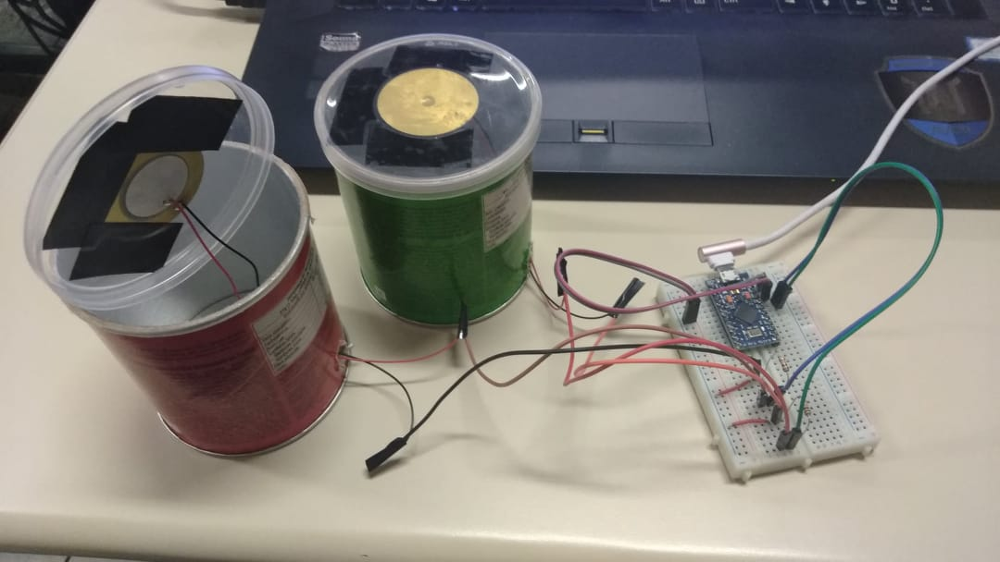

# Pringles Drums — Arduino USB Keyboard

[](https://github.com/kleberandrade/pringles-drums-arduino-joystick/actions/workflows/ci.yml)


[](LICENSE)

Turn two Pringles cans and piezo discs into a two-pad rhythm-game controller.
A **5V/16MHz Arduino Pro Micro (ATmega32U4)** reads the sensors on **A2/A3**
and sends **`w`/`d` USB keyboard pulses**. The repository name is historical:
this firmware implements keyboard HID, with no joystick axes, gamepad reports,
MIDI output, audio synthesis or velocity-sensitive notes.



## Requirements

- A Pro Micro with native USB, ATmega32U4, **5V/16MHz**, USB data cable and the
  components in the [BOM and assembly guide](docs/hardware.md).
- Python **3.13** (validated with 3.13.18) with `venv` and pip; PlatformIO Core **6.1.19**.
- For host tests: a C++11 compiler (Clang or GCC), POSIX shell and sanitizer
  runtime; on Windows use WSL for these scripts.
- Internet access for the first build. No Arduino IDE libraries need to be
  installed globally. The project pins Atmel AVR **5.3.0**, framework **5.4.0**,
  AVR toolchain **1.70300.191015** (GCC 7.3.0), and Keyboard **1.0.7**.

The original drawing depicts a Pro Mini/ATmega328P. **A Pro Mini, Uno R3 or Nano
ATmega328P cannot run this native USB Keyboard firmware.** The exact historical
prototype board revision is unverified. A 3.3V/8MHz Pro Micro needs a different
board target and recalibration and is not validated by this project.

## Install and quick start

```sh
git clone https://github.com/kleberandrade/pringles-drums-arduino-joystick.git
cd pringles-drums-arduino-joystick
python3 -m venv .venv
. .venv/bin/activate
python -m pip install -r requirements-dev.txt
./scripts/test.sh
./scripts/example.sh
pio run -e promicro-calibration -e promicro-hid
```

These commands test and compile only; they never upload or access a keyboard
interface. The example prints a synthetic trace and checks the exact output:

```text
13ms press w
33ms release w
96ms press w
116ms release w
```

## Assemble, calibrate, then play

1. Follow the [hardware guide](docs/hardware.md), including series resistors,
   external clamps, common GND and sensor mounting. Disconnect USB while wiring.
2. Leave **D4 open**. Explicitly select the serial port belonging to your board:

   ```sh
   pio device list
   pio run -e promicro-calibration -t upload --upload-port YOUR_BOARD_PORT
   pio device monitor -e promicro-calibration --port YOUR_BOARD_PORT
   ```

3. [Calibrate the pads](docs/calibration.md) at 115200 baud. This default build
   sends serial readings and makes no Keyboard calls, even with D4 grounded.
4. Close the monitor and upload the opt-in keyboard build:

   ```sh
   pio run -e promicro-hid -t upload --upload-port YOUR_BOARD_PORT
   ```

5. Focus your rhythm game, then close a switch between **D4 and GND** to arm.
   Hit A2's pad for `w` and A3's pad for `d`. Open D4 to stop sending new keys and
   release held project keys on the next loop. Arm only when the intended app
   has focus; USB keyboards type into whichever app is active.

The upload/play steps above are instructions for the builder, not automated
validation performed on this project. No physical upload or game session has
been tested during modernization.

## Behavior and configuration

Each channel clips ADC samples at 40, averages up to 25 samples, triggers above
10 and rearms below 1. A new hit also needs 30ms since the previous accepted hit.
Each accepted, armed hit holds its own key for 20ms. Both pads can be held
together; releases affect only that channel's key.

- [`include/drums.hpp`](include/drums.hpp): pure `PadSensor<Window>::update(raw,
  now)` returns one hit edge; `level()` and `active()` expose calibration state.
  `KeyPulse::update(hit, now, enabled)` returns `None`, `Press` or `Release`.
  Tune the named attack/release/ceiling/retrigger/hold constants here.
- [`include/board_config.hpp`](include/board_config.hpp): pad pins, key mapping,
  arm pin and sampling/report periods. Keep keys distinct and supported by
  Arduino Keyboard; the supplied mapping uses its default US layout.
- [`src/main.cpp`](src/main.cpp): Arduino ADC, serial and Keyboard adapter.
  `DRUMS_ENABLE_HID` defaults to zero; PlatformIO enables it only in `promicro-hid`.

Sampling is best-effort at a minimum interval of 1ms, without catch-up reads.
Serial reports are throttled to 20ms and skipped when the USB buffer is full.
The filter uses a partial window at startup and changes feel when the sampling
period changes. This is a simple polling controller, not a guaranteed latency
instrument: Arduino USB calls and the host can introduce delays.

## Tests and maintenance

```sh
./scripts/test.sh     # Four isolated executables, ASan + UBSan, warnings as errors
./scripts/example.sh  # Synthetic trace compared with examples/expected.txt
pio run -e promicro-calibration -e promicro-hid
```

Tests cover filter startup/wrap, exact thresholds, clipping, ringing suppression,
release/retrigger, millis rollover, simultaneous channels, arm/disarm, serial
backpressure and calibration mode. Arduino/USB are fakes in host tests: these
do not prove electrical safety, USB enumeration, input latency or game behavior.

[CI workflow](.github/workflows/ci.yml) runs the same checks on Ubuntu 24.04 with
Python 3.13.18 for pushes to `main` and pull requests. The CI badge above
reflects the published workflow on `main`; no coverage percentage is claimed.
`requirements-dev.in` records the direct tool dependency; `requirements-dev.txt`
pins its transitive dependencies for Python 3.13 across platforms. To update it
with uv, run `uv pip compile --universal --python-version 3.13 --no-header
--no-annotate requirements-dev.in --output-file requirements-dev.txt`, then
reinstall and rerun all checks.

The tools `crapper`, `dryer` and `mutator` currently do not support this C++ code.
See [the work log](WORK_LOG.md) for validation details and limitations.

## Repository layout

```text
src/                 Arduino entry point and transport
include/             Board configuration and portable signal/pulse logic
tests/               Host behavior tests and Arduino/Keyboard fakes
examples/            Executable synthetic trace and expected output
scripts/             Test and example runners
docs/                Hardware, wiring, calibration and migration
images/              Preserved prototype, historical wiring and signal captures
.github/workflows/   CI configuration
```

See [migration notes](docs/migration.md) before replacing an old sketch. There
is no longer a standalone `.ino` entry point or runtime dependency on the
third-party queue.

## Background and references

The original prototype was made for *Legend's Beats*, a rhythm game where hits
trigger attacks. Its old shortened game/survey links and external screenshot
were removed because availability and ownership could not be established.
Historical development videos remain useful context, not current setup guides:
[Keyboard](https://www.youtube.com/watch?v=3Bw8QX_qXLc),
[piezo sensors](https://www.youtube.com/watch?v=wedDKFGgjJs),
[filter and cans](https://www.youtube.com/watch?v=3L8o1plSuC0).

Primary hardware references are linked in the [hardware guide](docs/hardware.md).
See also [Arduino Keyboard](https://github.com/arduino-libraries/Keyboard/tree/1.0.7)
and the [PlatformIO Pro Micro board definition](https://docs.platformio.org/en/latest/boards/atmelavr/sparkfun_promicro16.html).

## License

Project-owned code and original documentation are [MIT licensed](LICENSE),
copyright Kléber de Oliveira Andrade. See [third-party notices](THIRD_PARTY.md)
for upstream library licenses and historical artwork limitations.
