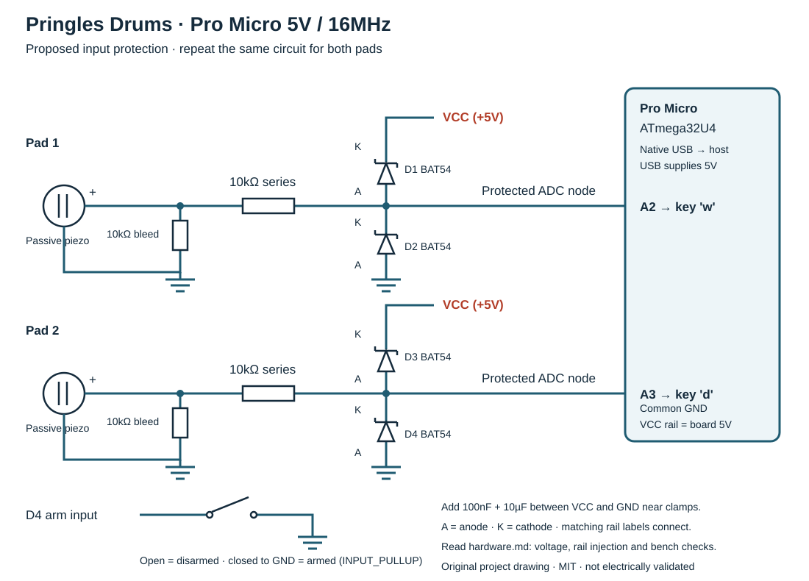

# Hardware and assembly

## Supported board and mapping

Use a **Pro Micro, ATmega32U4, 5V/16MHz**, with native USB and its matching
bootloader. Check the chip marking and oscillator/board voltage before uploading.
The selected PlatformIO board is `sparkfun_promicro16`.

- Pad 1 positive signal: protected node to **A2**, mapped to keyboard **`w`**.
- Pad 2 positive signal: protected node to **A3**, mapped to keyboard **`d`**.
- Both piezo negative leads and protection grounds: **GND**.
- **D4**: normally open arm switch to GND; configured as `INPUT_PULLUP`.
- **VCC**: the board's regulated 5V rail for upper clamp cathodes. Do not use RAW.
- USB supplies power and carries serial/HID. No separate power supply is needed.

There are no driven drum outputs, speakers or MIDI ports. Pin labels here are
Arduino board labels, not ATmega package pin numbers.

## Bill of materials

- 1 × 5V/16MHz Pro Micro (ATmega32U4) and matching USB **data** cable.
- 2 × approximately 27.5mm passive piezo discs, one for each pad. Do not substitute
  an active buzzer. The original sensor manufacturer/part number is unknown.
- 2 × empty, clean Pringles cans with lids, foam/tape and strain relief.
- 2 × 10kΩ, ¼W bleed resistors across the piezos (preserves the prototype value).
- 2 × 10kΩ, ¼W series resistors between piezo positives and analog nodes (added).
- 4 × low-forward-voltage Schottky diodes, e.g. **Nexperia BAT54**, two per input.
  For SOT23 singles use suitable breakout boards; confirm anode/cathode in the
  exact package datasheet. BAT54A/C/S are different dual configurations.
- 1 × normally open switch/jumper for D4 to GND.
- Breadboard/perfboard, insulated wire, solder, heat shrink; 100nF ceramic and
  10µF rail decoupling near the clamp circuit (observe electrolytic polarity).
- Multimeter and, for checking strike transients, an oscilloscope with suitable
  probe. Serial ADC readings alone cannot verify protection.

## Wiring

The SVG is original, editable project artwork. The circuit is a proposed
protected revision; it has **not been built or electrically validated**.

For **each** channel:

1. Connect piezo negative to GND. Connect its positive lead to a 10kΩ bleed
   resistor to GND. This discharges the piezo and controls sensitivity.
2. From piezo positive, pass through the separate 10kΩ **series** resistor to the
   analog node. Connect that node to A2 for pad 1 or A3 for pad 2.
3. Upper Schottky: **anode at analog node, cathode at VCC**.
4. Lower Schottky: **anode at GND, cathode at analog node**.
5. Share GND between sensors and the board. Place clamps close to the input.
   Decouple the VCC/GND rails. Never connect the piezo directly to VCC.
6. Wire D4 through a normally open switch to GND. Opening it disarms HID.

Power off while assembling. Check for shorts and diode polarity before powering
USB. Use strain relief so a strike cannot pull solder joints into another net.

## Voltage and protection limits

A passive piezo generates **bipolar, potentially high-voltage transients**.
Software clipping at 40 ADC counts is filtering only; it does not limit voltage
at the pin. A parallel resistor alone is not a verified overvoltage protector.

The [ATmega16U4/32U4 datasheet](https://ww1.microchip.com/downloads/en/DeviceDoc/Atmel-7766-8-bit-AVR-ATmega16U4-32U4_Datasheet.pdf),
sections “Absolute Maximum Ratings” and “Analog Input Circuitry”, specifies
−0.5V to VCC + 0.5V as absolute pin stress limits (except RESET/VBUS) and recommends
an analog source impedance of about 10kΩ or less. The normal ADC range is
**GND through VCC**; absolute limits are not an operating target.

The external diodes divert positive transients to VCC and negative transients to
GND; the series resistor limits their current. Use the
[Nexperia BAT54 datasheet](https://assets.nexperia.com/documents/data-sheet/BAT54.pdf)
to check forward voltage at the actual pulse current, reverse rating, leakage,
package and temperature. It specifies a maximum forward voltage of 0.32V at
1mA and 0.4V at 10mA under its test conditions. These values do not characterize
an unknown piezo or guarantee safe input voltage in your assembly.

As a sizing example, a +20V source before a 10kΩ series resistor with a 5.4V
clamped node would produce roughly (20 − 5.4) / 10000 = **1.46mA**. This is a
calculation, not a measured maximum strike voltage or a qualified protection
rating. Confirm real peak currents/voltages, resistor pulse dissipation and rail
rise under the hardest intended strikes with an oscilloscope. Increase series
resistance or use a properly designed front end if needed, then recalibrate.

Clamping into VCC can raise the supply or back-power an unpowered board. Do not
strike connected piezos while the board is unpowered; decoupling alone does not
solve rail injection. If the supply cannot absorb measured clamp current, use
a front end with suitable rail sinking/isolation before relying on it.

The series resistor plus piezo/bleed impedance can exceed the ADC's recommended
source impedance. This simple knock detector tolerates less precision than a
measurement instrument, but settling, interchannel coupling and sensitivity
still require bench checks. A buffer/amplifier may be necessary for accurate or
fast sensing. None is implemented here. The original 10kΩ bleeds are less
sensitive than the 1MΩ in Arduino's basic knock example; replacing them changes
the response and requires recalibration.

## Mechanical assembly

Attach one piezo per lid/pad using a thin compliant adhesive or foam layer, with
insulation between exposed metal and conductive surfaces. Do not strike the
bare ceramic directly. Support each can, protect sharp edges and add strain
relief to the leads. Separate the cans mechanically to reduce crosstalk. Start
with light taps and verify each channel in calibration mode before harder play.

## Historical artifacts and sources

[Original breadboard image](../images/Pingle%20Drums.png) is retained for history;
it shows a Pro Mini and omits the added protection. It is **not the build guide**.
The original [signal capture](../images/Signals.png) predates the current timing
and is not a current measurement.

- [SparkFun Pro Micro repository and design files](https://github.com/sparkfun/Pro_Micro)
- [SparkFun 5V/16MHz pinout](https://cdn.sparkfun.com/datasheets/Dev/Arduino/Boards/ProMicro16MHzv1.pdf)
- [PlatformIO target](https://docs.platformio.org/en/latest/boards/atmelavr/sparkfun_promicro16.html)
- [Arduino knock example](https://docs.arduino.cc/built-in-examples/sensors/Knock/)

Manufacturer sources support the component facts above. Protection values,
mounting and signal timing still need validation on the actual build.
